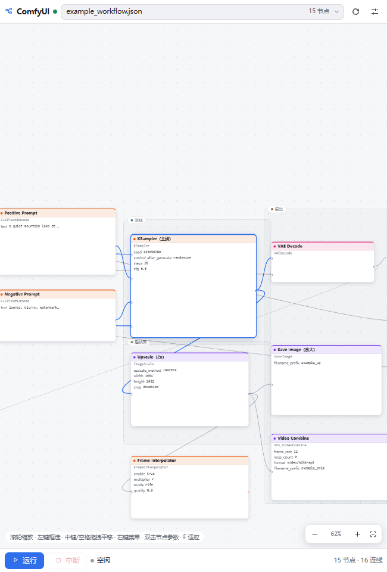
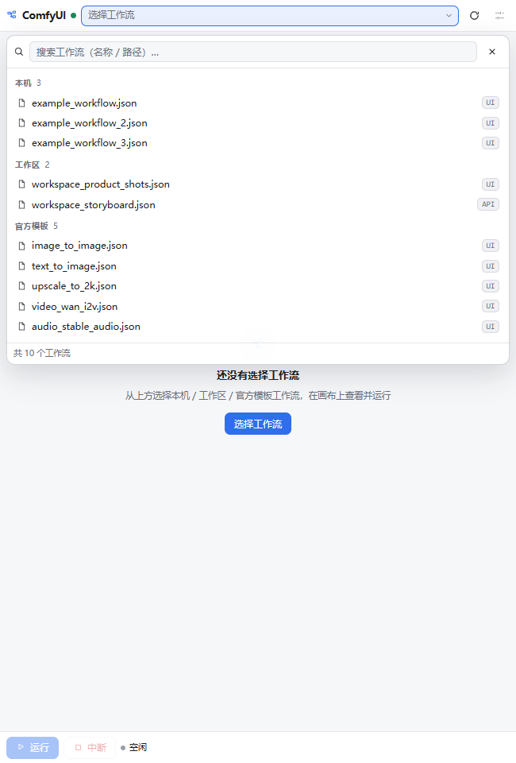
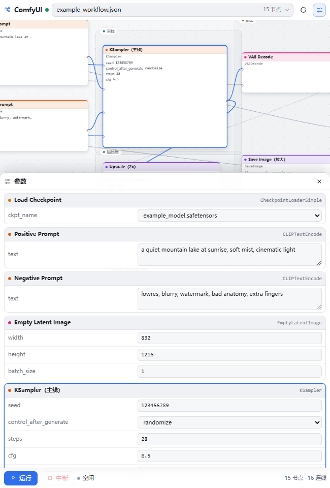
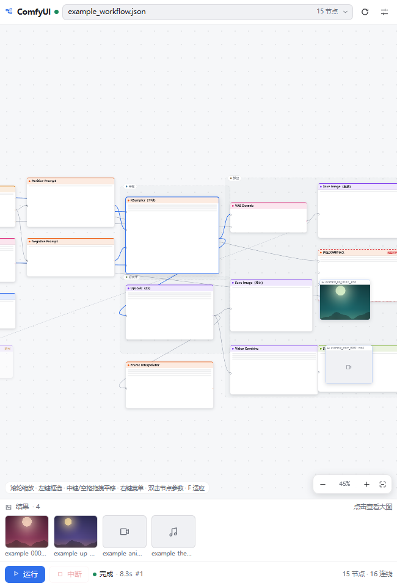
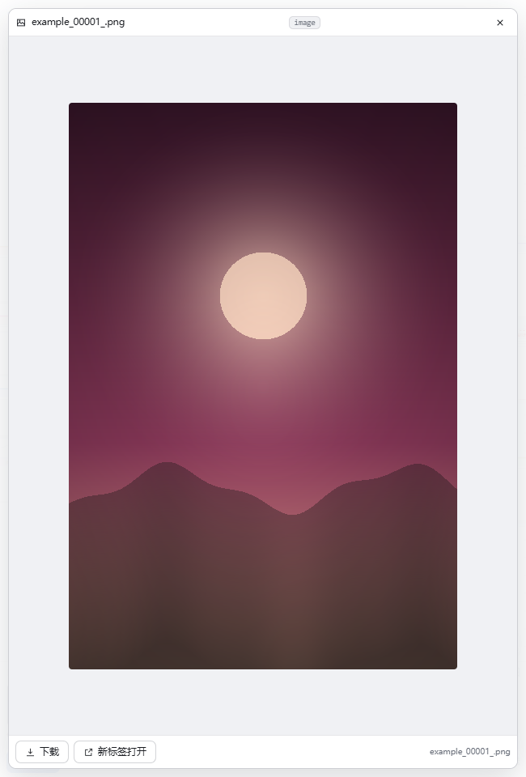
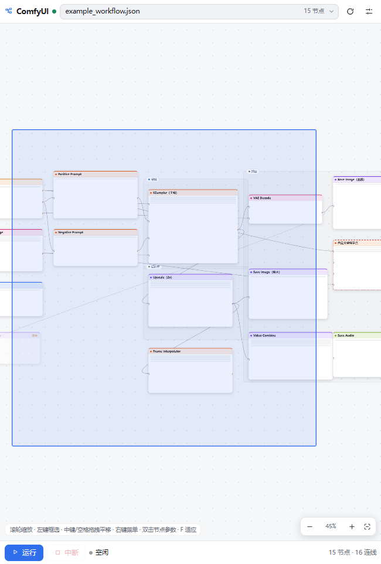
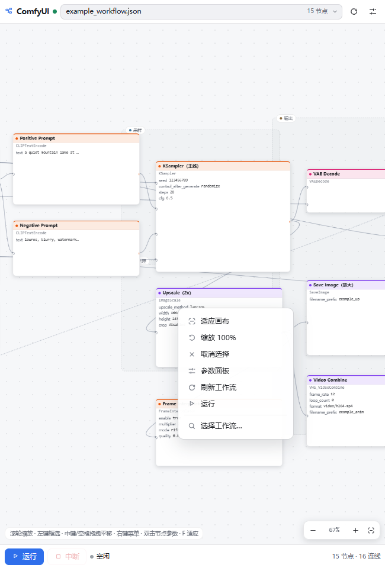
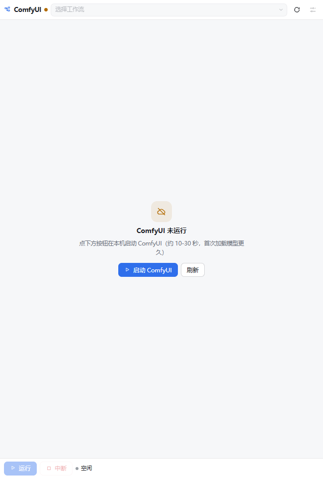
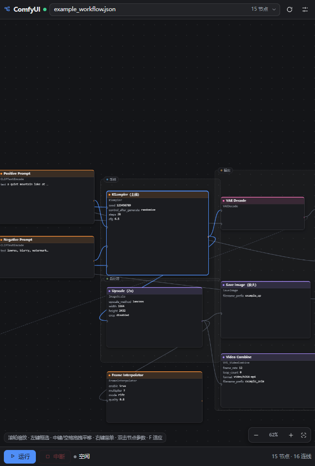
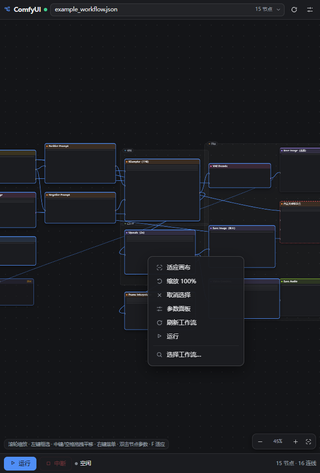

# dsh-comfy

> **ComfyUI 工作流画布 · DSH（DeepSeek Harness）桌面版右侧边栏插件**
> 在右侧边栏里以「无限画布」的方式浏览、改参数、运行本机 ComfyUI 工作流 —— 原生面板，**不是内嵌浏览器**。

[](LICENSE)
-0f1115)




## 为什么做这个

DSH 右侧边栏原本只能用一个浏览器标签页打开 ComfyUI 的 Web UI —— 那是「另一个应用套在侧栏里」。
这个插件把 ComfyUI 的**工作流数据**直接接到 DSH 原生的右侧栏标签页上：节点图用无限画布画出来，
参数在面板里改，运行由宿主进程直连 ComfyUI API，结果图直接回到画布上。

- 入口：右侧边栏顶部 `+`（开始页）→ **ComfyUI** 胶囊 → 打开「ComfyUI」标签页
- 和「无限画布 / 工作区文件 / 浏览器」并列，每个会话独立记住标签页与视图状态

## 特性

| 能力 | 说明 |
|---|---|
| 工作流来源 | 本机 `user/default/workflows` + `user/workflows`、工作区自定义目录、ComfyUI 官方模板（约 295 个，可搜索、按来源分组、标注 UI/API 格式） |
| 无限画布 | 平移 / 缩放 / 适应、分组框、贝塞尔连线、节点卡片（按类别着色）、静音/绕过/缺失类型状态、缩放 <50% 自动 LOD 骨架卡片、连大图自动聚焦到采样/导演节点 |
| ComfyUI 习惯操作 | 左键框选、中键/空格拖拽平移、右键上下文菜单（画布 / 节点 / 结果卡片）、双击节点改参数、`F` 适应 |
| 参数编辑 | 按节点分组列出全部可编辑控件（文本 / 数字 / 开关 / 下拉），改动只作为本次运行的覆盖值（`"<nodeId>.<输入名>"`），不写回工作流文件 |
| 运行 | ▶ 运行 / ■ 中断，800ms 轮询进度，显示状态、耗时、队列位置；未知节点 / 缺必填 / 子图等错误用中文提示 |
| 结果 | 底部结果条 + 画布结果卡片（可拖动），大图浮层支持下载 / 新标签打开；图片、视频、音频、3D、文本按类型渲染 |
| 离线自愈 | ComfyUI 未启动时一键「启动 ComfyUI」（宿主侧后台调你的启动脚本），起来后自动连上 |
| 主题 | 浅色 / 深色跟随系统，颜色全部走 DSH `--dsw-alias-*` 设计令牌 |

## 画布操作

| 操作 | 行为 |
|---|---|
| 左键点击节点 | 选中；点节点**标题**打开参数抽屉 |
| **左键拖拽空白** | **框选**（半透明选框，松开选中所有相交节点；`Shift` 追加；空白单击取消选择） |
| **中键（滚轮按下）拖拽** | **平移**（也支持 `空格+左键`、`Alt+左键`） |
| 滚轮 | 以指针为中心缩放（15%–250%） |
| **右键** | **上下文菜单**：空白 = 适应画布 / 缩放 100% / 取消选择 / 参数面板 / 刷新工作流 / 运行 / 选择工作流…；节点 = 打开参数 / 居中显示 / 复制节点类型 / 复制节点标题；结果卡 = 预览大图 / 下载 / 在新标签打开 / 从画布移除 |
| 双击节点 | 打开参数并居中放大 |
| 双击空白 / `F` / ⛶ | 适应画布（最小 45%，避免缩到看不清） |
| `Esc` | 关闭右键菜单 / 参数抽屉 / 大图预览 |

## 截图

| | |
|---|---|
|  |  |
| 工作流画布（示例工作流，非真实工程） | 工作流选择器（本机 / 工作区 / 官方模板） |
|  |  |
| 单击节点标题打开参数抽屉 | 运行完成：结果条 + 画布结果卡片 |
|  |  |
| 大图预览 / 下载 / 新标签打开 | 左键拖拽框选 |
|  |  |
| 空白画布右键菜单 | ComfyUI 未启动时的离线态（一键启动） |
|  |  |
| 深色模式 | 深色模式下的右键菜单 |

## 工作原理

```
浏览器（右侧栏标签页）                        宿主进程（DSH Desktop profile）
┌───────────────────────────┐  same-origin   ┌────────────────────────────────┐
│ client.js                 │ ─────────────▶ │ /api/dsh-comfy/*  （仅 loopback）│
│  · 右侧栏 tab 类型 + 入口   │   fetch/img    │  · 工作流来源发现 + 路径安全校验  │
│  · 无限画布 / 参数 / 运行   │ ◀───────────── │  · UI/API → 统一 Graph 归一化     │
│  · 结果条 / 大图预览        │                │  · UI 工作流 → ComfyUI API prompt│
└───────────────────────────┘                │  · 队列 / 历史 / 输出代理          │
                                             └───────────────┬────────────────┘
                                                             │ HTTP /prompt /history /view
                                                      ┌──────▼───────┐
                                                      │   ComfyUI    │ 127.0.0.1:8188
                                                      └──────────────┘
```

宿主端点（全部 `/api/dsh-comfy/*`，仅 loopback，JSON，错误统一 `{ok:false,error}`）：

`GET /status` · `POST /start` · `GET /workflows` · `GET /workflow?id=` · `POST /run` ·
`GET /progress?promptId=` · `POST /interrupt` · `POST /clear-queue` · `GET /history?limit=` ·
`GET /view?filename=&subfolder=&type=`

详细数据结构（Graph / OutputRef / 转换规则）见 [docs/ARCHITECTURE.md](docs/ARCHITECTURE.md)。

## 安装

**前置**：DSH 桌面版（在 0.1.5 / 0.2 预览版上开发验证）、本机可运行的 ComfyUI（默认探测 `127.0.0.1:8188`，其次 `8189`）、Node.js ≥ 20（仅构建/自检需要）。

1. 把仓库克隆到插件目录（不要直接放进 profile 的 `node_modules`）：

   ```powershell
   git clone https://github.com/Link-h1j/dsh-comfy.git D:\plugins\dsh-comfy
   ```

2. 安装到 DSH profile（以 `desktop` profile 为例）：

   ```powershell
   # ① 链接到 profile 依赖（Windows 用 junction；pnpm link 亦可）
   cmd /c mklink /J "%USERPROFILE%\.dsh\profiles\desktop\node_modules\dsh-comfy" "D:\plugins\dsh-comfy"
   # ② 在 profile 的 cordis.patch.yml 末尾追加：
   #   - insert:
   #       - id: dsh-comfy
   #         name: dsh-comfy
   ```

3. 重启 DSH 桌面版。右侧边栏 `+` → **ComfyUI** 即出现。

> 也可以在会话里直接让 DSH Agent 用插件管理器从本地目录安装（`plugin_manager install_bundle` 指向克隆目录），效果相同。

### 本机私有配置（config.local.json）

插件默认按 ComfyUI 的常见布局自动找路径；如果本机的 ComfyUI 装法不同（比如安装目录不在默认位置、工作流放在别的盘），
复制 `config.example.json` 为 `config.local.json` 填自己的路径即可。**这个文件已在 .gitignore 里，不会被提交**：

```json
{
  "comfyHome": "C:\\ComfyUI",
  "workspaceRoot": "C:\\ComfyUI\\workflows",
  "startScript": "C:\\ComfyUI\\start_comfyui.ps1"
}
```

优先级：环境变量 → `config.local.json` → 内置默认值。

### 配置（环境变量）

宿主侧在 DSH 启动时读取，改完需重启 DSH：

| 变量 | 默认值 | 说明 |
|---|---|---|
| `DSH_COMFY_URL` | 自动探测 `127.0.0.1:8188` → `8189` | ComfyUI 服务地址 |
| `DSH_COMFY_HOME` | `config.local.json` → `~/ComfyUI` | ComfyUI 安装根目录（读 `user/workflows`、官方模板） |
| `DSH_COMFY_WORKSPACE` | `config.local.json` → `<comfyHome>/workflows` | 额外的工作流目录（递归扫描） |
| `DSH_COMFY_TEMPLATES` | `config.local.json` → `<comfyHome>/.venv/.../templates` | 官方工作流模板目录 |
| `DSH_COMFY_START_SCRIPT` | `config.local.json` → 插件同级目录的 `start_comfyui.ps1` | 「启动 ComfyUI」按钮调用的脚本（`.ps1`） |

## 工作流格式

- **UI 格式**（`{nodes, links, groups}`）：节点位置 / 尺寸 / 分组按原样绘制；参数优先取新前端的 `widgets_values_named`，老文件按 `/object_info` 位置回退并给出警告。
- **API 格式**（`{prompt:{id:{class_type, inputs}}}`）：自动分层布局生成画布，可直接运行。
- `Note / MarkdownNote / Reroute / PrimitiveNode` 作为小卡片显示（不参与运行）；静音 / 绕过节点会置灰并在转换时正确处理。
- 官方模板里的前端 **子图（Subgraph）节点**目前只能查看、不能运行（会给出中文提示）。

## 目录

```
dsh-comfy/
  index.js             宿主入口（挂 /api/dsh-comfy 路由）
  lib/                 宿主：http / comfy / sources / graph / convert / runner / start / routes
  client.body.js       浏览器半可读源码（CJS，单文件，仅 require('react')）
  client.js            构建产物（不要手改；tools/build-client.mjs 生成）
  tools/               开发自检：build-client / preview / shot / client-smoke
                       dev-server / smoke / validate / fixtures
  locale/              zh.json / en.json（插件管理器展示信息）
  icon.svg             插件图标
  docs/                架构说明 + 截图
```

## 开发与自检

```powershell
node tools\build-client.mjs --check   # client.js 是否与 client.body.js 同步
node tools\build-client.mjs           # 重新生成 client.js（语法闸门）
node tools\client-smoke.mjs           # 客户端 117 项断言（fake ctx + SSR + 纯函数）
node tools\preview.mjs                # jsdom 渲染 12 个状态 → tools\preview-out\*.png（需 jsdom/react，见下）
node tools\dev-server.mjs             # 独立宿主 127.0.0.1:8199（不需要 DSH），可 curl 调试
node tools\smoke.mjs                  # 宿主 90 项断言（含真实排队 64×64 小任务）
node tools\validate.mjs               # 批量转换本地工作流 + 全部官方模板
```

- `preview.mjs` / `client-smoke.mjs` 需要 jsdom 与 react/react-dom：用 `DSH_COMFY_JSDOM_ROOT`、`DSH_COMFY_REACT_ROOT` 指向包含它们的工程目录（默认按 `<插件>/../apps/<project>` 查找，找不到时需显式设置）。
- `smoke.mjs` / `dev-server.mjs` 默认连 `127.0.0.1:8188`（或 `DSH_COMFY_URL`），需要一个运行中的 ComfyUI。
- 改完 `client.body.js` 后重建 `client.js` 并刷新页面；改完 `lib/` 建议重启一次 DSH（Node ESM 对嵌套模块的缓存不会随插件开关完全失效）。

## 已知限制

- 官方模板中的**子图（Subgraph）节点**只能查看不能运行；其余模板能否运行取决于本机已安装的自定义节点。
- 参数编辑只作为本次运行的覆盖值，不回写工作流 JSON（避免误改源文件）。
- 画布节点位置、结果卡片位置是本次会话的本地内存状态，不持久化。
- 结果输出依赖 ComfyUI 自己的输出目录，通过 `/view` 代理；`/history` 只列最近 50 条。
- 右侧栏宽度有限，超大工作流需要平移/缩放浏览。

## 卸载

插件管理器里停用或移除 `dsh-comfy`；源码目录可保留。

## 相关插件

- [dsh-image-canvas](https://github.com/Link-h1j/dsh-image-canvas) —— 同一个右侧栏里的「无限画布」：
  把打开的图片收进一张可平移缩放的画布，支持批注、把批注交给 Agent，以及用本机 ComfyUI 改图/出图。

## License

[MIT](LICENSE) © 2026 Link-h1j

---

## English overview

**dsh-comfy** is a native right-sidebar plugin for the DSH (DeepSeek Harness) desktop app that brings
ComfyUI *workflows* into the sidebar as an infinite canvas — no embedded browser. Browse workflows from
your ComfyUI installation / workspace / official templates, inspect the node graph, edit widget values
(run-scoped overrides), run or interrupt the prompt, and see images/videos/audio/3D outputs land on the
canvas or in the results strip.

Interaction follows ComfyUI conventions: left-drag to box-select, middle/space-drag to pan, right-click for
context menus (canvas / node / result card), double-click a node for parameters, `F` to fit.

The host half (`lib/`, `/api/dsh-comfy/*`, loopback-only) discovers workflow files, normalizes UI/API graphs,
converts UI workflows to ComfyUI API prompts, and proxies queue / history / output requests to ComfyUI.
The browser half is a single `window.__ModuleLoader__` bundle that only requires `react`.

Requirements: DSH Desktop, a local ComfyUI (auto-detected on 8188, then 8189), Node ≥ 20 for the dev tools.
See the Chinese sections above for install steps and environment variables (`DSH_COMFY_URL`, `DSH_COMFY_HOME`,
`DSH_COMFY_WORKSPACE`, `DSH_COMFY_TEMPLATES`, `DSH_COMFY_START_SCRIPT`).
